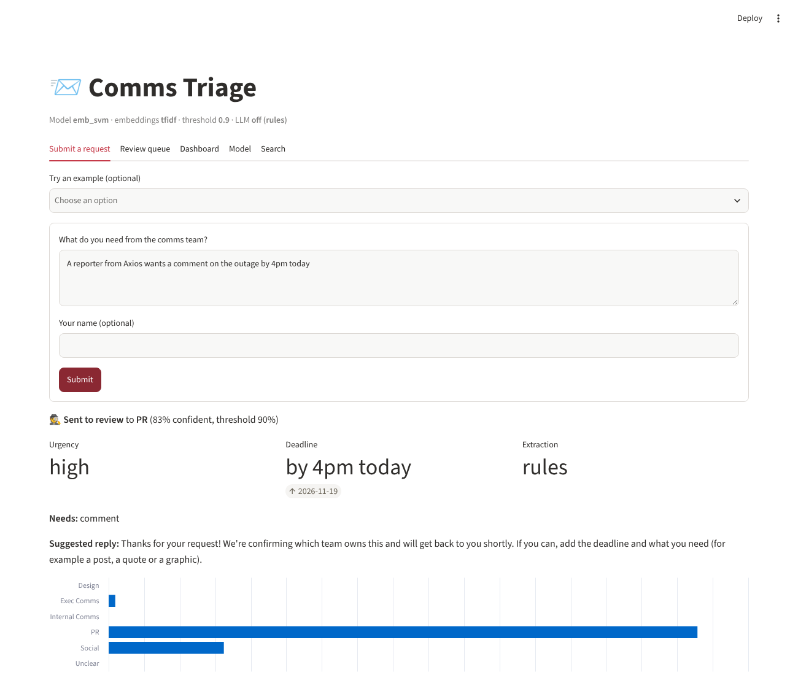

# Comms Triage

An intake and routing assistant for a communications team. People post requests in Slack or a web form
("A reporter needs a quote by 3pm", "Can design make a banner?", "Add this to the newsletter"). The system:

1. **Classifies** the request to the owning team (PR, Social, Design, Internal Comms, Exec Comms) using sentence
   embeddings and a calibrated classifier.
2. **Routes by confidence.** Confident predictions go straight to the team's channel. Uncertain ones, and vague
   messages like "hey, quick question", go to a review queue where a person picks the team with one click.
3. **Extracts** urgency, deadline and what is being asked for (rules, or an LLM if one is configured).
4. **Retrieves** related past requests and earlier announcements, with links, using a FAISS index.
5. **Drafts a first reply**, and stores every request and decision in Postgres.
6. **Learns from reviews.** Every human correction is exported as labeled data for the next training run.



## Why this project

At Technip Energies I built an ERP ticket classifier with a 0.80 confidence threshold and manual review routing.
Communications teams have the same problem in a different department: a steady stream of requests across many
channels, and someone has to read each one, work out who owns it, and find related past work. This project
applies that approach to comms, then measures where it breaks.

## How it works

```
Slack #comms-requests / web form
          │ webhook / HTTP
          ▼
   FastAPI service ── classifier (team + confidence)
          │              │
          │        confidence ≥ threshold and not "Unclear"?
          │           yes │                │ no
          │               ▼                ▼
          │        team channel      #triage-review (buttons)
          │                                │ click → POST /review
          ├── field extraction (LLM or rules): urgency, deadline, assets
          ├── FAISS search: past requests + announcements, with links
          ├── reply draft (LLM or template)
          ▼
   Postgres (every request, prediction and human decision)
          ▼
   Streamlit dashboard  ·  GET /feedback → retraining data
```

| Part | Code | Comes from |
|---|---|---|
| Team classifier, threshold, review queue | `classify/`, `service.py` | Technip ticket triage |
| Model comparison, ensemble, rare classes | `classify/models.py` | Mint Sage |
| Retrieval with citations, HitRate@k and MRR | `retrieve/`, `eval/retrieval_eval.py` | SousChef |
| Rewording, informal and typo stress tests | `perturb.py`, `eval/robustness.py` | SmallHands |

## Results

Numbers below are from the **offline TF-IDF backend** (what CI and the tests use). The MiniLM backend runs in the
`sbert` CI job; its results appear in that job's summary on GitHub Actions.

**Test set:** 44 handwritten requests that the model never sees in training, in any form.

| Metric | Value |
|---|---|
| Test accuracy / macro F1 | 84% / 0.85 |
| Share routed automatically (threshold 0.90) | 55% |
| Accuracy on the automatically routed requests | 100% (24 of 24) |
| Vague requests sent to review | 100% |
| Same model at threshold 0.80: auto routed / accuracy | 68% / 97% |
| Retrieval HitRate@1 / HitRate@3 / MRR (30 queries) | 97% / 100% / 0.98 |
| Rule extraction on test: urgency accuracy / deadline phrase match | 80% / 100% |

**Model selection** (5 fold cross validation, grouped so variants of one request never sit in two folds):

| Candidate | CV accuracy | CV macro F1 |
|---|---|---|
| TF-IDF + logistic regression (baseline) | 77% | 0.76 |
| Embeddings + logistic regression | 82% | 0.81 |
| **Embeddings + calibrated linear SVM (chosen)** | **82%** | **0.82** |
| Embeddings + SVM/XGBoost ensemble | 80% | 0.80 |

**Robustness** (`reports/robustness.md`). "Robust" is trained with extra informal and typo variants.
Rewording is a transform it never trains on.

| Variant | Base accuracy | Robust accuracy |
|---|---|---|
| Clean | 84% | 84% |
| Reworded | 84% | 84% |
| Informal ("yo can some1 post…") | 86% | 86% |
| Typos (~6% of letters) | 77% | **84%** |
| Two requests in one message (either team counts) | 98% | 98% |

**What I learned**
* **Variety beats volume.** With only 66 training requests plus 9 template variants each, test accuracy was 45%.
  Adding 225 *new, different* requests raised it to 80% and then 84%. Rephrasing the same 66 requests 9 more
  times added almost nothing.
* **The threshold matters more than the model.** The best candidates differ by 1 to 2 points, while moving the
  threshold from 0.80 to 0.90 trades 13 points of automation for 3 points of accuracy on the requests that skip
  review. The threshold is chosen on out of fold predictions, as the lowest one that keeps automatic routing
  at least 95% accurate.
* **Typos were the real weakness**, and targeted augmentation fixed them. Character n-grams made the TF-IDF
  model fairly tolerant of informal text already.
* **Multi-team messages get lower confidence** (only 32% routed automatically compared with 55% for normal ones),
  which is the right behavior: people should split those.

**Caveats, stated plainly**
* The seed requests and the 225 extra requests were written with an LLM (Claude) for this prototype, and the
  same LLM wrote the test set. The test set is therefore not independent. **The next step is a test set of
  requests written by other people**, or real anonymized requests from a team.
* 44 test requests means each one is about 2 percentage points. Treat differences under 5 points as noise.
* The knowledge base is 15 fictional announcements, so retrieval is an easy benchmark. Use
  `fetch_rss.py` on a real public blog feed for a harder one.
* The extraction rules were written while looking at the labeled requests, so their scores are optimistic.

## Run it

### Option A: Docker (everything, including Postgres)

```bash
cp .env.example .env        # optional: add an LLM key or Slack tokens
docker compose up --build
```

* Dashboard: http://localhost:8501
* API docs: http://localhost:8000/docs

The trainer container trains both models, builds the search index and runs every evaluation, then exits. After
that the API and dashboard start. The first build downloads CPU PyTorch and MiniLM (about 1 GB in total). For a
small offline image:

```bash
INSTALL_SBERT=false EMBEDDING_BACKEND=tfidf docker compose up --build
```

Load demo traffic so the dashboard has data:

```bash
python scripts/simulate.py --n 40
```

### Option B: locally

```bash
python -m venv .venv && source .venv/bin/activate
make install            # core packages
make install-sbert      # optional: MiniLM embeddings (otherwise set EMBEDDING_BACKEND=tfidf)
make train              # trains, indexes and evaluates; writes artifacts/ and reports/
make test
make api                # terminal 1
make dashboard          # terminal 2
```

## Adding a free LLM (optional)

Without an LLM, extraction and reply drafts use rules and templates, and everything still works. With one,
urgency and asset extraction and the reply drafts get better. Any OpenAI compatible endpoint works, set in `.env`:

| Provider | Free limit | `LLM_BASE_URL` |
|---|---|---|
| Groq | daily request limit per model, resets daily, no card | `https://api.groq.com/openai/v1` |
| Cloudflare Workers AI | 10,000 Neurons per day | `https://api.cloudflare.com/client/v4/accounts/<ACCOUNT_ID>/ai/v1` |
| Ollama (your laptop) | unlimited | `http://localhost:11434/v1` |

Then compare the LLM against the rules on the same test set:

```bash
python eval/extraction_eval.py          # rules
python eval/extraction_eval.py --llm    # LLM, falls back to rules on any error
```

If the LLM returns a deadline that does not appear in the request, it is dropped. Rate limits and outages fall
back to rules automatically.

## Slack setup (about 10 minutes)

1. In your workspace, create the channels `#comms-requests`, `#triage-review`, `#team-pr`, `#team-social`,
   `#team-design`, `#team-internal-comms` and `#team-exec-comms`.
2. Go to https://api.slack.com/apps, choose **Create New App**, then **From a manifest**, pick your workspace and
   paste [`slack_manifest.yml`](slack_manifest.yml).
3. **Install to Workspace**. Copy the **Bot User OAuth Token** (`xoxb-...`) into `.env` as `SLACK_BOT_TOKEN`.
4. **Basic Information**, then **App-Level Tokens**, then **Generate Token** with the `connections:write` scope.
   Copy it (`xapp-...`) into `.env` as `SLACK_APP_TOKEN`.
5. In each of the seven channels, type `/invite @Comms Triage`.
6. Start everything with the bot:
   ```bash
   docker compose --profile slack up --build
   ```
   or locally, with the API running: `make slack`.
7. Post a request in `#comms-requests`. Confident requests appear in the team channel with a thread reply.
   Uncertain ones appear in `#triage-review` with a button per team.

Socket Mode means Slack connects out to the bot, so no public URL or ngrok is needed. Never commit `.env`.

## Using your own data

* `data/seed/seed_requests.jsonl`: handwritten requests with team, urgency, deadline and assets. The split puts
  40% of each team in the test set.
* `data/synthetic/llm_generated.jsonl`: extra varied requests used only for training.
* `data/knowledge/*.jsonl`: documents to search. Add a public feed with
  `python -m comms_triage.data.fetch_rss <feed url> --out data/knowledge/rss_blog.jsonl`.
* After people review requests, export their decisions and retrain:
  ```bash
  curl -s localhost:8000/feedback > data/feedback.jsonl
  FEEDBACK=data/feedback.jsonl make train
  ```

## CI

`.github/workflows/ci.yml` runs on every push:
1. Tests, the full pipeline with TF-IDF, and a **quality gate** (`eval/check_gate.py`) that fails the build if test
   macro F1, accuracy when auto routed, the share routed automatically, retrieval HitRate@3 or accuracy on typos
   drop below set minimums.
2. The full pipeline with MiniLM embeddings, with results in the job summary.
3. A Docker image build that runs the tests inside the container.

## Project layout

```
src/comms_triage/
  config.py              settings from environment variables
  classify/train.py      grouped CV, model selection, threshold choice, final test
  classify/models.py     candidate classifiers
  embeddings.py          MiniLM (sbert) and offline TF-IDF+SVD embedders
  extract/               rules, LLM extraction with validation, reply drafts
  retrieve/index.py      FAISS index with source links
  service.py             the triage pipeline
  api/main.py            FastAPI endpoints
  integrations/          Slack bot (Socket Mode) and Block Kit cards
  perturb.py             rewording, informal, typo and multi-team transforms
  data/                  split, augmentation, RSS fetcher
dashboard/app.py         Streamlit: submit, review queue, dashboard, model, search
eval/                    robustness, retrieval, extraction, quality gate, summary
scripts/                 full pipeline, demo traffic
tests/                   pytest suite (runs offline)
docs/discovery.md        questions for interviewing a comms team before building
```
